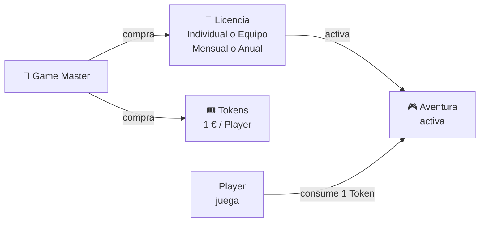

# 🪙 Tokens y Licencias

:::info 👑 Quién necesita leer esto
**Game Master** — esta página te ayuda a entender el modelo económico de AdventuriQ para presupuestar tus Aventuras.
:::

AdventuriQ funciona con un modelo sencillo y transparente basado en dos elementos: **Licencias** (para crear Aventuras) y **Tokens** (para que los Players jueguen). Aquí tienes todo lo que necesitas saber para planificar tu inversión.

## 💡 La economía de AdventuriQ en 30 segundos

El modelo económico de AdventuriQ se resume en dos pasos: el Game Master adquiere una Licencia para activar su Aventura y compra los Tokens que necesita para sus Players. Cada Player consume un Token al iniciar su partida.

*Precios sin impuestos. Los impuestos aplicables se calculan durante el proceso de compra según la legislación vigente y el país de facturación.*

## 📄 Licencias de Aventura

Una **Licencia** es lo que activa tu Aventura en la plataforma. Sin ella, la Aventura permanece en estado Draft y no es accesible para los Players.

AdventuriQ ofrece cuatro tipos de Licencia por Aventura, según el **modo de juego** (individual o equipo) y la **duración** (mensual o anual):

| Tipo | Precio | Duración | Modo de juego | Rankings disponibles |
|---|---|---|---|---|
| **Licencia Mensual (individual)** | 18 € / mes | 30 días desde la publicación | Individual | Ranking de jugadores |
| **Licencia Mensual (equipo)** | 36 € / mes | 30 días desde la publicación | Equipo | Ranking de jugadores + ranking por equipos |
| **Licencia Anual (individual)** | 200 € / año | 12 meses desde la publicación | Individual | Ranking de jugadores |
| **Licencia Anual (equipo)** | 400 € / año | 12 meses desde la publicación | Equipo | Ranking de jugadores + ranking por equipos |

Además de estas cuatro, existe la **[Licencia Parking](#-licencia-parking-aparcar-una-aventura)** (mensual o anual), que no sirve para jugar sino para **conservar** una Aventura que no se está usando, a un coste menor.

La elección entre **Individual y Equipo** se hace en el momento de [crear la Aventura](aventuras/crear-aventura) y determina si los Players compiten solo a nivel individual o también agrupados en equipos (clanes). Con una Licencia de Equipo, además del ranking individual, se generan rankings por equipo y del jugador dentro de su equipo.

:::tip 🕐 La caducidad empieza cuando publicas, no cuando compras
Puedes comprar tu Licencia hoy y tomarte los días o semanas que necesites para construir tu Aventura. El contador solo empieza a correr en el momento en que **publicas la Aventura** y los Players pueden empezar a jugarla. Sin prisas, sin presión temporal durante la creación.

Si **renuevas** la Licencia de una Aventura que ya está publicada, la Licencia nueva empieza a contar en el momento en que se la asignas.
:::

### Estados de una Licencia

| Estado | Qué significa |
|---|---|
| **Asignable** | Comprada y todavía sin fecha de caducidad: no está asignada a ninguna Aventura o la Aventura aún no se ha publicado. |
| **Activa** | Asignada a una Aventura publicada y con fecha de caducidad futura (1 mes o 1 año según el tipo). |
| **Caducada** | La fecha de caducidad ya ha pasado. |

### ¿Qué pasa cuando caduca una Licencia?

Cuando una Licencia vence, la Aventura deja de ser accesible para los Players: en la revisión automática de cada noche, la Aventura publicada se **despublica** y recibes un correo con los motivos. La **configuración y el contenido se mantienen intactos** — solo tienes que activar una Licencia nueva para que vuelva a ser jugable.

Si no vas a jugarla durante un tiempo pero quieres conservarla tal cual (con el progreso y las fotos de los Players), asígnale una [Licencia Parking](#-licencia-parking-aparcar-una-aventura).

:::info
AdventuriQ te avisa por correo con antelación antes de la caducidad, para que puedas renovar sin interrupciones (ver [Avisos por correo](#-avisos-por-correo)).
:::

La Licencia se gestiona desde la [configuración de la Aventura](aventuras/configuracion) en el Gamifier.

:::tip ¿Cómo elegir tu Licencia?
- **Individual** si cada Player compite por separado. **Equipo** si quieres que los Players jueguen agrupados en equipos (clanes) con ranking por equipo.
- **Mensual** si tu Aventura dura 1-3 meses: máxima flexibilidad, pagas solo por lo que usas.
- **Anual** si tu Aventura va a estar activa 4 meses o más: te ahorras la gestión de renovaciones y optimizas coste.
- **[Planes Luna o Mundo](#-alternativa-planes-anuales)** si necesitas Players ilimitados o varias Aventuras.
- **[Branderización del Webapp](#branderizacion-del-webapp)** si quieres que los Players jueguen con tu identidad visual: es un servicio aparte que puedes contratar con cualquier Licencia o Plan.
:::

## 📧 Avisos por correo

AdventuriQ te escribe **antes** de que algo se acabe, para que puedas actuar a tiempo y tu Aventura no se despublique. Recibes un correo cuando:

| Situación | Cuándo te avisamos (por defecto) |
|---|---|
| La **Licencia** de una de tus Aventuras va a caducar y no tiene otra Licencia que la releve | Unos 7 días antes |
| Una **Licencia de Game Designer** va a caducar | Unos 7 días antes |
| Tu **Plan Luna o Mundo** va a caducar | Unos 30 días antes |
| Te quedan **pocos Tokens** (5 o menos) o se te han **agotado**, y tienes Aventuras publicadas que los consumen | En el mismo momento en que un Player gasta el Token que cruza el límite |
| Una **Aventura publicada** (o tu Plan) llega al **85 %** de su espacio, o al **100 %** | En cuanto ocurre |
| Tienes **Boosters** comprados hace más de 3 días que aún no has aplicado | Unos días después de la compra |

- Todos los avisos llegan **juntos en un único correo**, en tu idioma preferido (español o inglés), con un botón para ir directamente a la Aventura o a tu Perfil.
- **Cada situación se avisa una sola vez.** Si la resuelves (compras Tokens, renuevas la Licencia…) y más adelante vuelve a ocurrir, te avisamos de nuevo.
- No tienes que activar nada: los avisos llegan al correo de tu cuenta de Game Master. Los mismos avisos aparecen en tu [Perfil](gamifier/perfil-de-usuario.md#avisos).

<!-- 📸 CAPTURA PENDIENTE: /img/tokens-correo-avisos.png — Correo «Tienes 3 avisos sobre tu cuenta» con varios bloques (Tokens, Licencia, Booster) -->

:::tip Del correo a la solución en un clic
Si recibes, por ejemplo, «La licencia de *Mi Aventura* caduca el 21/11/2026», pulsa **Abrir la Aventura** en el correo y asigna una Licencia nueva desde el apartado **Licencia de Aventura** de su ficha. A partir de ahí no recibirás más avisos de esa Licencia.
:::

## 🚗 Licencia Parking: aparcar una Aventura

La **Licencia Parking** sirve para **aparcar** una Aventura que no se está jugando y conservarla entera a un coste menor que una Licencia de Aventura. Mientras está aparcada:

- Se conserva **todo**: el contenido, los archivos, el progreso de los Players y sus fotos.
- La Aventura **no se puede publicar ni jugar**.

| Parking | Duración |
|---|---|
| **Parking Aventura (Mensual)** | 31 días desde que se asigna a la Aventura |
| **Parking Aventura (Anual)** | 12 meses desde que se asigna a la Aventura |

A diferencia de las Licencias de Aventura, que empiezan a contar al publicar, el Parking empieza a contar **en cuanto lo asignas**. Se compra en la Tienda y llega a tu cuenta como cualquier otra Licencia.

### Aparcar una Aventura

1. Abre la Aventura desde el listado de Aventuras.
2. Si está publicada, cambia su estado a **Draft** y guarda: con la Aventura publicada, las Licencias Parking aparecen desactivadas en el selector con el texto «Despublica la Aventura para poder asignarle un Parking.».

3. En el apartado **Licencia de Aventura**, pulsa **Asignar licencia**.
4. Elige **«Parking Aventura (Mensual)»** o **«Parking Aventura (Anual)»** (insignia con una «P») y pulsa **Seleccionar**.
5. Pulsa **Guardar Aventura**.

El apartado muestra la insignia de Parking y el aviso **«Aventura aparcada»**: se conservan sus archivos, el progreso de los Players y sus fotos, pero no se puede publicar. El aviso indica también **hasta qué día** dura el Parking, que aparece además en **Caduca en**.

### Si la Aventura ya tenía una Licencia de Aventura

Lo que ocurre al guardar depende de si esa Licencia ya ha empezado a contar:

| La Licencia de Aventura… | Qué pasa al guardar con el Parking |
|---|---|
| **Está sin estrenar**: la Aventura nunca se ha publicado (recién creada, duplicada o importada) y **Caduca en** está vacío | El Parking pasa a ser la Licencia de la Aventura y la Licencia anterior **vuelve a quedar libre**: la verás de nuevo en el selector para usarla en otra Aventura. |
| **Ya está en uso**: la Aventura se publicó, tiene fecha en **Caduca en** y todavía no ha caducado | El Parking **no se asigna ni se consume**: sigue disponible y sin empezar a contar. Aparece la ventana **«No se ha asignado el Parking»**: «La Aventura tiene una licencia vigente que ya está en uso. Podrás aparcarla con un Parking cuando esa licencia caduque.». Al cerrarla, la ficha vuelve a mostrar la Licencia de Aventura. |

Las Licencias ya caducadas siguen apareciendo en el historial de la Aventura, como hasta ahora.

### Reconocer las Aventuras aparcadas en el listado

En el [listado de Aventuras](aventuras/crear-aventura.md#-fechas-de-la-licencia-en-el-listado-de-aventuras), la tarjeta de Licencia de una Aventura aparcada con un Parking vigente se muestra en **lila**, con «Parking Aventura (Mensual)» o «Parking Aventura (Anual)» y sus fechas de **Compra** y **Caduca**. Un Parking caducado se muestra en naranja, como cualquier Licencia caducada.

### Volver a jugar una Aventura aparcada

1. Abre la Aventura aparcada y pulsa **Asignar licencia**.
2. Elige una **Licencia de Aventura** (mensual o anual) y guarda.
3. Cambia el estado a **Published**. Desde ese momento empieza a contar la nueva Licencia.

Si intentas publicar una Aventura aparcada sin cambiarle la Licencia, la ventana de motivos te lo indica: «Está aparcada con un Parking: asígnale una licencia de Aventura para poder publicarla.» (ver [¿Por qué no se ha podido publicar?](aventuras/publicar-aventura.md#-por-qué-no-se-ha-podido-publicar)).

:::note Lo que conviene saber del Parking
- **Espacio**: el Parking mantiene el límite de espacio que tenía la última Licencia de la Aventura, Boosters incluidos. Lo que quepa en ese límite se conserva entero.
- **No sirve para** publicar, crear una Aventura nueva, duplicar ni importar: esas pantallas no ofrecen las Licencias Parking.
- **Al caducar el Parking**, la Aventura sigue sin poder publicarse, igual que con una Licencia caducada. Para seguir conservándola, asígnale otro Parking o una Licencia de Aventura. Si una Aventura se queda mucho tiempo sin Licencia ni Parking, se acaba borrando: ver [Aventuras sin Licencia](#-aventuras-sin-licencia-avisos-y-borrado).
:::

## 🧹 Aventuras sin Licencia: avisos y borrado

Una Aventura **no publicada**, sin Licencia de Aventura vigente y sin Parking, que ocupa al menos 1 MB, se considera **inactiva**. Si pasa mucho tiempo así, AdventuriQ borra sus archivos, pero antes te avisa varias veces y siempre guarda una **copia en ZIP** que puedes descargar.

| Tiempo sin Licencia ni Parking (por defecto) | Qué pasa |
|---|---|
| **3 meses** | Recibes el correo «Una Aventura sin licencia se va a borrar». |
| **30 días** y **7 días** antes del borrado | Nuevos recordatorios por correo. |
| **6 meses** | Se borran los archivos de la Aventura (imágenes, vídeos, audios y fotos de los Players) y desaparece del listado. Recibes el correo «Hemos borrado los archivos de una Aventura inactiva». |

Mientras dura la cuenta atrás, la ficha de la Aventura muestra arriba el aviso en rojo **«Esta Aventura se borrará el (fecha).»**, con los días que faltan y cómo evitarlo.

<!-- 📸 CAPTURA PENDIENTE: /img/gamifier-aventura-inactiva-aviso-borrado.png — Ficha de una Aventura en cuenta atrás, con el aviso rojo de borrado -->

:::tip Cómo evitar el borrado
Asígnale una **Licencia de Aventura** (para volver a jugarla) o un **[Parking](#-licencia-parking-aparcar-una-aventura)** (para solo conservarla) desde **Asignar licencia** y pulsa **Guardar Aventura**. La cuenta atrás se cancela en el acto.
:::

### Recuperar una Aventura borrada

1. Abre tu **Perfil**, pestaña **Historial**, y baja hasta el bloque **«[Copias de seguridad](gamifier/perfil-de-usuario.md#copias-de-seguridad)»**: están todas tus copias en ZIP, las que has exportado tú y las que se guardaron antes de borrar una Aventura inactiva (columna «Origen»: **«Borrada por inactividad»**). La columna «Disponible hasta» indica hasta cuándo puedes descargarla.
2. Pulsa el botón **Descargar** (icono de flecha).
3. En el listado de Aventuras, pulsa **Importar** y sigue el asistente (ver [Exportar e importar una Aventura](aventuras/exportar-importar-aventura.md)). Se crea una Aventura nueva, en Borrador y con otro GamePIN.

:::warning Lo que la copia no guarda
La copia en ZIP guarda todo el diseño (Misiones, Retos, Objetos, textos, mapas, idiomas) y sus archivos, pero **no** las partidas, el progreso de los Players ni sus fotos. Si quieres conservar también eso, usa un **Parking**. La copia se guarda **1 año**; después se elimina y la Aventura ya no se puede recuperar.
:::

Las Aventuras de cuentas con un **Plan Luna o Mundo** no se borran. El plazo empieza a contar desde que caduca la última Licencia o el último Parking de la Aventura, pero nunca antes del 16 de noviembre de 2026.

## 🎟️ Tokens de juego

Un **Token** es el ticket de entrada de cada Player a una Aventura. Cada vez que un Player inicia una partida nueva, consume un Token.

| Aspecto | Detalle |
|---|---|
| **Precio** | 1 € por Token |
| **Quién lo consume** | El Player, al pulsar "Adelante" para iniciar la Aventura |
| **Cuándo se consume** | Una vez por partida nueva: la primera vez que el Player abre la Aventura y carga sus Misiones. Ni al registrarse, ni al añadir la Aventura por GamePIN, ni al desbloquearla con un código |

### Ejemplo concreto

Imagina que quieres lanzar una Aventura de team building para 30 personas **en modo individual**. Según la duración y el uso, estas son las tres configuraciones típicas:

**Escenario A — Evento puntual (1 mes):**

| Concepto | Unidades | Coste |
|---|---|---|
| Licencia Mensual (individual) | 1 | 18 € |
| Tokens para Players | 30 | 30 € |
| **Total** | | **48 €** |

**Escenario B — Campaña de 3 meses:**

| Concepto | Unidades | Coste |
|---|---|---|
| Licencia Mensual (individual) × 3 | 3 | 54 € |
| Tokens para Players | 30 | 30 € |
| **Total** | | **84 €** |

**Escenario C — Aventura activa todo el año:**

| Concepto | Unidades | Coste |
|---|---|---|
| Licencia Anual (individual) | 1 | 200 € |
| Tokens para Players | 30 | 30 € |
| **Total** | | **230 €** |

*Precios sin impuestos. Los impuestos aplicables se calculan durante el proceso de compra según la legislación vigente y el país de facturación.*

:::note ¿Y si necesitas modo Equipo?
Sustituye la Licencia Individual por la de Equipo: 36 € / mes o 400 € / año. El coste de Tokens se mantiene igual.
:::

:::tip Tres ventajas de los Tokens
- **No caducan**: los Tokens que compres hoy siguen válidos dentro de un año, dos o los que necesites.
- **Son fungibles**: un Token comprado para la Aventura A puede usarse en la Aventura B. No están vinculados a una Aventura concreta.
- **Precio plano y transparente**: 1 € por Token, sin tramos, sin letra pequeña, sin costes ocultos.
:::

### Qué consume y qué no consume un Token

| | Situación | ¿Consume Token? |
|---|---|---|
| ✅ | Un Player inicia una partida nueva en una Aventura | **Sí** |
| ✅ | Un Player entra por primera vez en una Aventura protegida con **código de acceso, QR o Token de acceso único** | **Sí** (1 Token, igual que sin bloqueo) |
| ✅ | Un Player reinicia su partida (si la Aventura permite volver a jugar) y empieza de nuevo | **Sí** |
| ❌ | Un Player continúa una partida ya empezada | No |
| ❌ | El Game Master hace un Raze (reset del progreso de los Players) | No |
| ❌ | El Game Master o Game Designer prueban la Aventura | No |
| ❌ | Cualquier partida en una Aventura cubierta por un **Plan Luna o Plan Mundo** activo | No (el límite es el espacio contratado) |

Puedes seguir tu saldo y cada suma y resta de Tokens en tu [perfil del Gamifier](./gamifier/perfil-de-usuario.md#movimientos-de-tokens), pestaña **Historial › Movimientos de tokens**. En la ficha de una Aventura, un guion (**-**) en el saldo de Tokens significa que tu cuenta todavía no tiene ningún movimiento, no que el saldo sea cero.

:::info Cada partida es un ticket de entrada independiente
Si un Player quiere repetir una Aventura — por ejemplo, en una segunda edición de una formación, para mejorar su puntuación o simplemente para volver a disfrutarla — consumirá un Token nuevo. Esto garantiza que siempre sabes exactamente cuánto cuesta cada experiencia.
:::

## 📦 Alternativa: Planes anuales

Si tu caso requiere volumen — muchos Players, muchas Aventuras o uso continuado a lo largo del año — los planes anuales te ofrecen **tarifa plana durante un año completo, sin renovaciones mensuales, con Players ilimitados**.

### Plan Luna

Una Aventura, Players ilimitados durante un año. Ideal si tienes una experiencia estable que se reutiliza con distintos grupos.

**Qué incluye:**

- 1 Licencia Anual de Aventura
- **Tokens en tarifa plana** — Players ilimitados todo el año
- Renovación anual

**Desde 750 € / año** *(precio sin impuestos)*

Tu caso encaja con Plan Luna si eres:

- **Ayuntamiento u oficina de turismo** con una ruta gamificada permanente.
- **Empresa con onboarding gamificado** que recibe nuevos empleados periódicamente.
- **Formador o docente** con un curso que reutilizas en varias ediciones.
- **Museo o espacio cultural** con una experiencia interactiva estable.
- **Organizador de un evento anual** (congreso, feria, jornadas) que se repite cada año.

:::info ¿Te interesa?
**[Consulta tu Plan Luna](mailto:start@adventuriq.com?subject=Consulta%20Plan%20Luna)** — te preparamos una propuesta adaptada a tu volumen y necesidades.
:::

### Plan Mundo

Aventuras ilimitadas, Players ilimitados durante un año. Pensado para organizaciones que gestionan un catálogo de experiencias gamificadas.

**Qué incluye:**

- **Licencias de Aventura ilimitadas** — crea todas las que necesites
- **Tokens en tarifa plana** — Players ilimitados todo el año
- Contratación anual

**Desde 3.600 € / año** *(precio sin impuestos)*

Tu caso encaja con Plan Mundo si eres:

- **Agencia de eventos o team building** que ofrece experiencias gamificadas a distintos clientes.
- **DMC o empresa turística** con un catálogo de rutas y actividades.
- **Empresa de formación** con múltiples cursos gamificados.
- **Departamento de RRHH** con programas continuos de engagement, cultura o desarrollo.
- **Consultora con metodologías propias** que gamifica procesos para sus clientes.

:::info ¿Te interesa?
**[Consulta tu Plan Mundo](mailto:start@adventuriq.com?subject=Consulta%20Plan%20Mundo)** — te preparamos una propuesta adaptada a tu catálogo y escala.
:::

:::info Los planes se ajustan a ti
Cada organización es diferente. [Contáctanos](mailto:start@adventuriq.com) y te preparamos una propuesta personalizada que se adapte a tu volumen, tu sector y tu forma de trabajar.
:::

## ✨ Branderización del Webapp {#branderizacion-del-webapp}

Puedes personalizar la Webapp que ven los Players con los **colores y el logo de tu organización**, en tu **propio dominio** o en un subdominio de AdventuriQ. Tus Players viven la Aventura con tu identidad visual, reforzando tu marca en cada momento del juego.

La branderización **se contrata y se cobra aparte**, y está disponible con **cualquier Licencia o Plan**, no solo con los planes anuales. [Contáctanos](mailto:start@adventuriq.com?subject=Consulta%20Branderizaci%C3%B3n) cuando la necesites. Una vez activa, sigues las versiones de tu App desde [Mi App](gamifier/mi-app.md).

## 📊 ¿Qué modelo me conviene?

| Escenario | Mejor opción |
|---|---|
| Evento puntual, 1-3 meses, Players compiten individualmente | **Licencia Mensual (individual)** + Tokens |
| Evento puntual, 1-3 meses, Players compiten por equipos | **Licencia Mensual (equipo)** + Tokens |
| Aventura activa todo el año, Players conocidos | **Licencia Anual (individual o equipo)** + Tokens |
| Aventura estable con muchos Players anuales | **Plan Luna** |
| Múltiples Aventuras en un catálogo profesional | **Plan Mundo** |
| Quieres tu marca en el juego (colores, logo y dominio) | **Branderización del Webapp**, con cualquiera de las opciones anteriores |

## ❓ Preguntas frecuentes

**¿Los Tokens caducan?**
No, nunca. Los Tokens que compres permanecen en tu cuenta indefinidamente hasta que se usen.

**¿Puedo usar Tokens en varias Aventuras distintas?**
Sí, los Tokens son fungibles. Un Token comprado inicialmente para una Aventura puede usarse en cualquier otra Aventura de tu cuenta.

**¿Qué pasa si compro más Tokens de los que uso?**
Se quedan en tu cuenta sin caducidad, listos para futuras Aventuras. No hay penalización ni pérdida.

**¿Hay descuentos por volumen de Tokens?**
No — el precio es plano: 1 € por Token independientemente de la cantidad. Si buscas volumen, valora los [planes anuales](#-alternativa-planes-anuales) que incluyen Tokens en tarifa plana.

**¿Licencia Mensual o Licencia Anual — cuál me conviene?**
Si tu Aventura va a estar activa 1-3 meses, la Licencia Mensual te da máxima flexibilidad. A partir del cuarto mes, la Licencia Anual empieza a ser más rentable y te ahorra la gestión de renovaciones. Si vas a tener muchos Players, considera los [planes anuales](#-alternativa-planes-anuales).

**¿Cuál es la diferencia entre Licencia Individual y de Equipo?**
La Licencia Individual genera solo un ranking de jugadores. La Licencia de Equipo añade rankings por equipo y del jugador dentro de su equipo, e incluye la gestión de equipos (clanes) desde el Gamifier. La elección se hace al [crear la Aventura](aventuras/crear-aventura) y determina el modo de juego.

**¿Qué pasa si mi Licencia caduca?**
La Aventura deja de ser accesible para los Players hasta que se active una nueva Licencia. La configuración y el contenido se mantienen intactos — solo tienes que activar una Licencia nueva para que vuelva a ser jugable. AdventuriQ te avisa por correo con antelación antes de que esto ocurra (ver [Avisos por correo](#-avisos-por-correo)).

**¿Cuándo empieza a contar la caducidad de la Licencia?**
La caducidad se activa cuando **publicas tu Aventura** (el momento en el que los Players pueden empezar a jugarla), no cuando compras la Licencia ni mientras la estás construyendo. Esto significa que puedes adquirir la Licencia con antelación y trabajar en tu Aventura a tu ritmo — el contador solo arranca al publicar. Si asignas una Licencia nueva a una Aventura que **ya está publicada** (por ejemplo, para renovarla), el contador arranca en ese momento; si la Aventura está en borrador, espera a que la publiques.

**¿Qué es la Branderización del Webapp?**
Es una personalización de la Webapp que ven los Players: colores corporativos y logo de tu organización, en tu propio dominio o en un subdominio de AdventuriQ. Refuerza tu marca en cada partida. Es un servicio que **se contrata y se cobra aparte** y que puedes añadir a cualquier Licencia o Plan.

**¿Un Raze consume Tokens?**
No. El Raze solo resetea el progreso de la Aventura — no consume ni devuelve Tokens. Es una herramienta para "limpiar" el estado de una Aventura sin coste adicional.

**¿Qué pasa si un Player quiere repetir la Aventura tras un Raze?**
Consumirá un Token nuevo al iniciar la nueva partida. Cada partida es un ticket de entrada independiente, lo que te permite presupuestar con total transparencia.

**¿Puedo pasar de pay-per-use a plan anual después?**
Sí, en cualquier momento. [Contacta con nosotros](mailto:start@adventuriq.com?subject=Cambio%20a%20plan%20anual) y te ayudamos a migrar al plan que mejor se adapte a tu caso.

## 🔑 Token de acceso único

Si quieres monetizar tu Aventura vendiendo acceso individual a tus Players, consulta [Token de acceso único](./tokens-acceso-unico.md) — un mecanismo que te permite generar códigos de un solo uso (limitados por tu saldo de Tokens) y venderlos al precio que decidas.

## 💾 Almacenamiento por Aventura

Cada Licencia de Aventura incluye un **límite de almacenamiento** para archivos multimedia (imágenes, vídeos y audios). El espacio se consume al subir archivos desde cualquier formulario del Gamifier: Aventura, Misión, Reto, Objeto Digital, POI, Clan o la [Biblioteca de Medios](gamifier/biblioteca-de-medios.md).

Si una Aventura llega al **100 %** de su espacio, el Game Master ya no puede subir más archivos, desde ningún formulario ni desde la Biblioteca de Medios. Al intentarlo aparece el aviso **«Límite de espacio alcanzado»**. Para seguir subiendo, borra archivos que no uses desde la Biblioteca de Medios o amplía el espacio de la Licencia con un [Booster](aventuras/configuracion.md#-ampliar-el-espacio-con-boosters) (+100 MB cada uno).

:::info Las fotos de los Players no se cortan de golpe
Para no interrumpir una partida en curso, los Players pueden seguir subiendo fotos y vídeos en los Retos de [Subir Foto](retos/subir-foto.md) con un **margen de cortesía** por encima del límite (por defecto, hasta el 150 % del espacio). Si la Aventura supera también ese margen, el Player ve el mensaje «Esta Aventura se ha quedado sin espacio y no admite más fotos ni vídeos. Avisa a quien la organiza.».
:::

Tu [perfil](gamifier/perfil-de-usuario.md#avisos) te avisa cuando una Aventura supera el 85 % de su espacio.

El espacio ocupado se puede consultar en la cabecera de la Biblioteca de Medios y en el listado de Aventuras, donde se muestra el indicador de consumo (ej. "127 MB / 1.46 GB").

## 📚 Continúa aprendiendo

| Siguiente paso | Qué encontrarás |
|---|---|
| [Crear una Aventura](aventuras/crear-aventura) | Cómo crear tu primera Aventura paso a paso |
| [Token de acceso único](tokens-acceso-unico.md) | Monetiza tus Aventuras con códigos de acceso individual |
| [Biblioteca de Medios](gamifier/biblioteca-de-medios.md) | Gestor de archivos multimedia y control de espacio |
| [¿Qué es AdventuriQ?](/) | Volver a la portada del manual |
